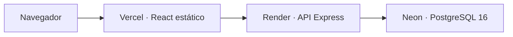

# Registro de equipos mineros

Aplicación web para registrar equipos, llevar su horómetro y consultar los mantenimientos realizados. El frontend está hecho con React y Vite; el API usa Express, TypeScript y PostgreSQL.

## Reglas principales

| Regla         | Comportamiento                                                                                                        |
| ------------- | --------------------------------------------------------------------------------------------------------------------- |
| Código        | Se recorta, se convierte a mayúsculas y debe ser único.                                                               |
| Tipo          | Se acepta camión, excavadora o perforadora.                                                                           |
| Horómetro     | Número entre 0 y 9 999 999.9, con hasta un decimal. No puede disminuir al editar.                                     |
| Mantenimiento | Se requiere al alcanzar el intervalo del tipo. Un equipo nuevo comienza su ciclo en 0 h.                              |
| Servicio      | Registrar un mantenimiento guarda el horómetro actual y reinicia el ciclo dentro de una transacción.                  |
| Historial     | Se puede consultar aunque el equipo todavía no requiera servicio; al borrar el equipo, se borra su historial.         |
| Edición       | `PATCH` acepta uno o más campos editables. El estado se calcula a partir del horómetro, el último servicio y el tipo. |

Los intervalos iniciales son camión **250 h**, excavadora **500 h** y perforadora **300 h**. Se pueden ajustar con una migración nueva; la aplicación no incluye una pantalla administrativa para editarlos.

## Arquitectura



Render Free puede dormir el backend después de 15 minutos sin tráfico; la primera solicitud posterior puede tardar alrededor de un minuto. Vercel Hobby es para proyectos personales o no comerciales. Se eligieron planes gratuitos y no se agrega un método de pago.

Las URLs públicas se completan cuando se ejecute el primer despliegue. Los nombres iniciales están en `.env.deploy.example`.

## Requisitos

- Node.js 22.12 o posterior dentro de la versión mayor 22.
- Docker Desktop para PostgreSQL local.
- Bash para `deploy.sh` (Git Bash o WSL en Windows).

## Desarrollo local

Desde la raíz del repositorio:

1. Copia `.env.example` como `.env`.
2. Inicia PostgreSQL: `docker compose up -d db`.
3. Instala dependencias: `npm ci --prefix backend` y `npm ci --prefix frontend`.
4. Aplica las migraciones: `npm --prefix backend run migrate`.
5. En una terminal ejecuta `npm --prefix backend run dev`.
6. En otra terminal ejecuta `npm --prefix frontend run dev` y abre `http://localhost:5173`.

La imagen local crea las bases `equipos` y `equipos_test` al inicializar el volumen. PostgreSQL se publica en el puerto `5433` para evitar chocar con una instalación local que ya use `5432`; el API escucha en `http://localhost:8080`.

## API

Los errores usan `{ "error": { "code": "…", "message": "…", "details": … } }`.

| Método   | Ruta                             | Función                                         |
| -------- | -------------------------------- | ----------------------------------------------- |
| `GET`    | `/health`                        | Estado de la API y conexión a la base.          |
| `GET`    | `/api/equipment-types`           | Tipos e intervalos de mantenimiento.            |
| `GET`    | `/api/equipment`                 | Inventario con estado calculado.                |
| `POST`   | `/api/equipment`                 | Crear equipo.                                   |
| `GET`    | `/api/equipment/:id`             | Consultar equipo.                               |
| `PATCH`  | `/api/equipment/:id`             | Editar campos del equipo.                       |
| `DELETE` | `/api/equipment/:id`             | Borrar equipo y su historial.                   |
| `POST`   | `/api/equipment/:id/maintenance` | Registrar mantenimiento y nota opcional.        |
| `GET`    | `/api/equipment/:id/maintenance` | Ver historial, del más reciente al más antiguo. |

## Pruebas y compilación

Con PostgreSQL local iniciado, ejecuta:

```sh
npm --prefix backend run typecheck
npm --prefix backend test
npm --prefix backend run build
npm --prefix frontend run build
```

Los tests usan la base separada `equipos_test`; no apuntes `TEST_DATABASE_URL` a una base con datos que quieras conservar. GitHub Actions repite tipos, formato, tests y builds al hacer push o abrir un pull request.

## Despliegue

La combinación gratuita es Neon para PostgreSQL, Render Free para el API y Vercel Hobby para el frontend. Render puede dormir el servicio y suspenderlo si se agotan los límites gratuitos. No añadas un método de pago si el objetivo es mantener el gasto en cero. Vercel Hobby solo admite uso personal/no comercial.

1. Confirma que la rama `main` del repositorio público esté actualizada.
2. En Render, ve a **Account Settings → Account Security → Git Deployment Credentials → Add credential → GitHub** y concede acceso al repositorio. No crees el servicio desde el selector del panel: `deploy.sh` lo crea en el plan Free. ([Conectar GitHub](https://render.com/docs/git-provider))
3. En Neon, abre **Connect**, selecciona la rama, base y rol del proyecto y copia la URL con **Connection pooling** activado en `DATABASE_URL`; desactívalo y copia la URL directa en `MIGRATION_DATABASE_URL`. ([Conexiones Neon](https://neon.com/docs/connect/connection-pooling))
4. En Render, crea una API key desde **Account Settings → API Keys** y copia el ID de workspace desde **Workspace Settings**. ([API de Render](https://render.com/docs/api))
5. Crea o abre tu cuenta de Vercel con GitHub, elige Hobby y crea un token desde **Account Settings → Tokens**. Hobby es gratis para uso personal/no comercial; no inicies una prueba Pro ni agregues una tarjeta. El script crea el proyecto Vercel si aún no existe. `VERCEL_SCOPE` queda vacío para una cuenta personal. ([Plan Hobby](https://vercel.com/docs/plans/hobby))
6. Copia `.env.deploy.example` a `.env.deploy` y completa allí las claves y URLs localmente. No las pegues en GitHub ni en el chat.
7. Ajusta `FRONTEND_URL` si el dominio predeterminado de Vercel está ocupado. Debe ser el dominio exacto del proyecto, porque el backend solo acepta ese origen.
8. Desde Bash, en la raíz del repositorio, ejecuta `./deploy.sh --check` y luego `./deploy.sh` (o `make deploy`). El script construye ambos proyectos antes de tocar producción, aplica las migraciones, configura y despliega el backend, publica el frontend y comprueba health, HTML, CORS y tipos.

`.env.deploy` se interpreta como un archivo de asignaciones Bash. Pon entre comillas los valores de Neon, tokens y URLs. No pegues esos valores en GitHub, en el chat ni en archivos versionados.

Códigos de salida: `10` configuración/preflight, `11` ya hay otro despliegue en curso, `20` build local, `30` migraciones, `40` despliegue Render, `41` health o rollback de Render, `50` despliegue Vercel y `60` verificación pública.

La publicación requiere credenciales de las cuentas. En este repositorio todavía no se registran URLs públicas; se mostrarán cuando el primer despliegue termine correctamente.

## Variables de entorno

- `.env`: configuración de desarrollo local; parte de `.env.example`.
- `.env.deploy`: tokens y conexiones de producción; parte de `.env.deploy.example` y siempre local.
- `VITE_API_URL`: URL pública del backend, insertada en el build del frontend. Es pública por diseño; nunca pongas claves en variables `VITE_*`.

Las migraciones usan conexión directa. El servicio web usa la URL agrupada de Neon. El API valida la configuración al iniciar, limita CORS al frontend configurado y devuelve mensajes genéricos para errores internos.

## Uso de IA

Herramientas de IA usadas: OpenAI Codex como apoyo de planificación, implementación y revisión del código.

## Limitaciones y decisiones

- Las cuentas gratuitas pueden tener límites de uso, reinicios y tiempos de espera. No se ofrece una garantía de disponibilidad.
- El proyecto no incluye autenticación; está pensado para una demostración o uso personal controlado, no para datos sensibles.
- El historial conserva notas de texto libre, limitadas a 1000 caracteres.
- La selección de Render Free en lugar de Fly.io responde al requisito de no añadir tarjeta ni generar cobros.
- Más detalles: [`docs/DECISIONES.md`](docs/DECISIONES.md).
